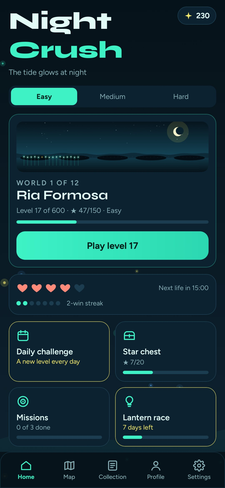
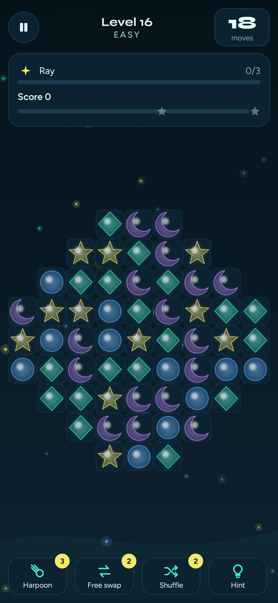
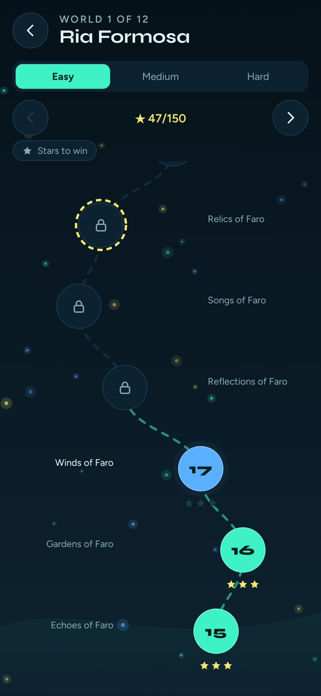
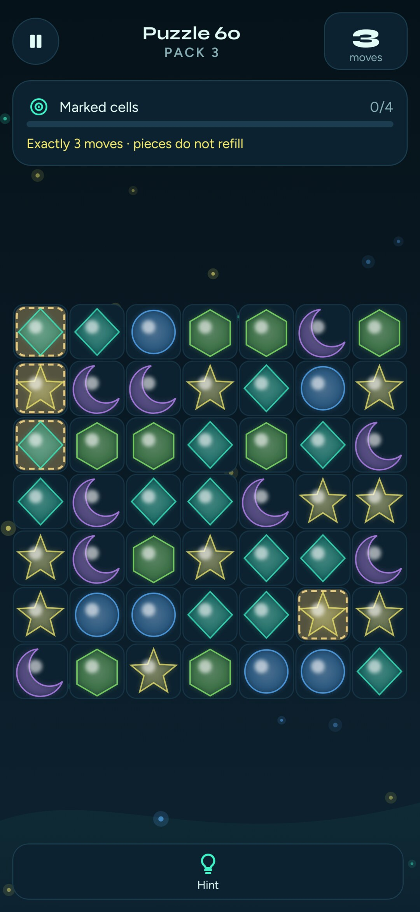

**English** · [Português (Portugal)](README.pt-PT.md)

<h1 align="center">
  
</h1>

<p align="center">
  A match-3 game for Android, set on the Portuguese coast at night.<br>
  600 levels, 12 worlds and 100 puzzles. No ads, no tracking, no internet.
</p>

<p align="center">
  <a href="https://github.com/SyscallBrain/night-crush/releases/latest"></a>
  <a href="https://github.com/SyscallBrain/night-crush/actions/workflows/ci.yml"></a>
  <a href="LICENSE"></a>
  
  
  
</p>

<p align="center">
  <a href="https://github.com/SyscallBrain/night-crush/releases/latest"><b>Download</b></a> ·
  <a href="#features">Features</a> ·
  <a href="#building-from-source">Building</a> ·
  <a href="#how-it-works">How it works</a> ·
  <a href="#contributing">Contributing</a>
</p>

## About

NightCrush is a match-3 game set on the Portuguese coast after dark. You swap glowing plankton to make rays, jellyfish, lanternfish and abyss pearls, then combine them. Each level you win lights one point on that world's coastline, so the shore fills with light as you play, from the Ria Formosa lagoon to the deep Atlantic.

Every level is certified. The solver that ships in the repository plays each of the 1,800 level variants to a win, and the build replays those solutions before it will produce an APK. If any solution stops replaying, there is no APK.

The game is complete and runs entirely offline. It has no ads, accounts, analytics or purchases, and the only permission it asks for is vibration.

<p align="center">
  
  
  
  
</p>

## Features

### Campaign

- **600 levels** in 12 worlds of 50, each playable in Easy, Medium and Hard, for 1,800 certified variants.
- **Four specials:** the ray clears a row or column, the jellyfish bursts its neighbours, the lanternfish swims to a target, and the abyss pearl clears every piece of one colour.
- **Eleven special combinations,** from the cross of light (ray and ray) to the spring tide (two abyss pearls).
- **Seven goals:** collect colours, clear silt, deliver lanterns to the exits, fill orders, break blockers, spread the glow and free seahorses. Some levels run against the clock.
- **A new obstacle in every world:** barnacles, silt, coral, nets, oil slicks, whirlpools, sea currents, pufferfish, giant oysters, sinkholes and an octopus that throws ink.
- **Full Moon levels** with a gold ring on the map, and a world chest at the top of every path.

<details>
<summary><b>The twelve worlds</b></summary>
<br>

| # | World | Levels | Introduces |
|---:|---|---|---|
| 1 | Ria Formosa | 1–50 | the four specials, special combinations, barnacles |
| 2 | Sagres | 51–100 | silt in one and two layers |
| 3 | Arrábida | 101–150 | lanterns and exits, diagonal sliding |
| 4 | Berlengas | 151–200 | coral and orders |
| 5 | Nazaré | 201–250 | nets and the first timed levels |
| 6 | Vicentine Coast | 251–300 | oil slicks that spread |
| 7 | Azores Fajãs | 301–350 | whirlpools and seahorses |
| 8 | Porto Moniz | 351–400 | sea currents |
| 9 | Benagil Cave | 401–450 | pufferfish and spreading glow |
| 10 | Savage Islands | 451–500 | giant oysters |
| 11 | Abyssal Trench | 501–550 | sinkholes |
| 12 | Deep Atlantic | 551–600 | the octopus and everything together |

</details>

### Ways to play

- **Daily challenge:** one level a day per difficulty, which never costs a life, with a history of your results.
- **Endless:** certified levels one after another, getting harder, with leftover moves carried forward.
- **90-second rush:** score as much as you can, and cascades add time.
- **Zen:** an open board with no goals, no score and no pressure.
- **100 puzzles** in four packs: fixed boards with no refills, where the marked cells must be cleared in exactly N moves. The solver checks each one, so N moves always works and N−1 never does.

### Progression

- Lives, pearls, boosters, and a win streak that starts your next level with a ray, a jellyfish or a lanternfish.
- Star chests and world chests with an opening animation, a daily reward, three daily missions and a weekly event with five tiers.
- **The coast that lights up:** a hand-drawn panorama for each world with 50 lights, one for each level.
- **A collection of 108 stickers,** with nine sea creatures for each world.
- **48 achievements** and a profile with win rate by difficulty, specials made, best cascade and free-play records.

## Accessibility

- Colour-blind palettes for deuteranopia, protanopia and tritanopia, plus high-contrast symbols drawn on every piece.
- **TalkBack on the board:** every cell reads its piece, special, blocker and layers, custom actions swap it with a neighbour, and each move is announced.
- Reduced motion, which follows the system setting until you change it, plus animation speed at 1×, 1.5× or 2×.
- Larger text, a left-handed layout, separate volumes for effects and music, and a confirmation before shuffling.

## Privacy

NightCrush collects nothing, and it is built so that it cannot.

- **No internet permission:** the app has no way to send data anywhere.
- **One permission only:** `VIBRATE`, for haptic feedback.
- No ads, accounts, analytics, third-party SDKs, Google Play Services or in-app purchases.
- Your progress stays on the device. You can export it to a file and import it back yourself.

## Installation

1. Download `NightCrush-v1.0.0.apk` from the [latest release](https://github.com/SyscallBrain/night-crush/releases/latest).
2. Open it on your phone. Android asks once to allow installs from your browser or file manager.

NightCrush requires Android 8.0 (API 26) or newer. It speaks English and European Portuguese and follows the phone's language.

## Building from source

| Tool | Version |
|---|---|
| JDK | 17 or newer (built with 21) |
| Android SDK | platform `android-37.1` and build tools 37 |
| Gradle | wrapper included (9.8.0) |

```bash
git clone https://github.com/SyscallBrain/night-crush.git
cd night-crush
export JAVA_HOME=/path/to/jdk ANDROID_HOME=/path/to/android-sdk

./gradlew :app:assembleDebug        # app/build/outputs/apk/debug/app-debug.apk
bash tools/verify.sh                # everything CI runs: tests, strict validation, certificate replay, lint, APK
```

No emulator is needed. The screens can be rendered on the JVM with Robolectric:

```bash
./gradlew :app:testDebugUnitTest -PncShots --tests '*ScreenshotTest*'   # PNGs in app/build/screenshots (PT) and /en
```

A release build is signed only when `nightCrush.release.*` properties are set in `~/.gradle/gradle.properties`. Without them it is built unsigned.

## How it works

The project has three Gradle modules that share one rules engine:

| Module | What it holds |
|---|---|
| `:core` | The engine in pure Kotlin/JVM: matching, specials and combinations, gravity with diagonal sliding, blockers, goals, scoring, deterministic shuffling and a canonical SHA-256 state hash. It has no Android, no wall clock and no platform `Random`, only a versioned SplitMix64. |
| `:leveltool` | A content CLI that generates levels from structural families, calibrates difficulty with a simulated player, solves every variant and writes replayable certificates. It also generates and certifies the puzzles. |
| `:app` | Jetpack Compose UI. The board is drawn in a single `Canvas` with pre-rendered sprites, and the animations are built from the engine's event timeline. |

```
content/
├── catalog.json            12 worlds and one entry per level (revision, sha256)
├── levels/world-NN/        600 level files
├── certificates/level-N/   easy, medium and hard solutions with state hashes
└── puzzles/puzzles.json    100 puzzles with their solutions
```

The game, the solver and the certificate verifier all call the same `GameEngine.applyMove`, so a certificate is proof that a human can win that exact level. Any change to the engine that a player could notice bumps `ENGINE_VERSION`, and every certificate has to be regenerated. On every build, `validateGameContent` checks the catalog hashes and replays the certificates and puzzles. `exportGameAssets` then packs the content into the APK with a SHA-256 manifest.

## Contributing

Bug reports, translations, accessibility feedback and pull requests are welcome. Please read [CONTRIBUTING.md](CONTRIBUTING.md) first. In short, rules go in `:core` with tests, visible text goes in `strings.xml` in both languages, and new content must pass `validate --strict` with certificates that replay.

## Credits

Made by **Tiago Correia** ([tiagorcorreia87@gmail.com](mailto:tiagorcorreia87@gmail.com)).

Fonts: [Syne](https://fonts.google.com/specimen/Syne) and [Figtree](https://fonts.google.com/specimen/Figtree), both under the SIL Open Font License. The sound effects and music are synthesised offline by [`tools/generate_sounds.py`](tools/generate_sounds.py).

## License

NightCrush is released under the [MIT License](LICENSE).
