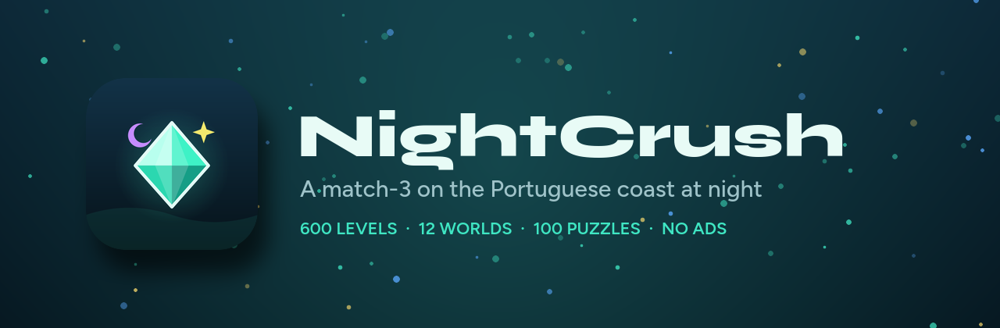
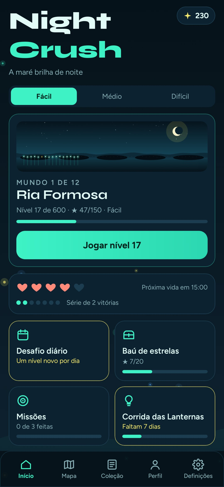
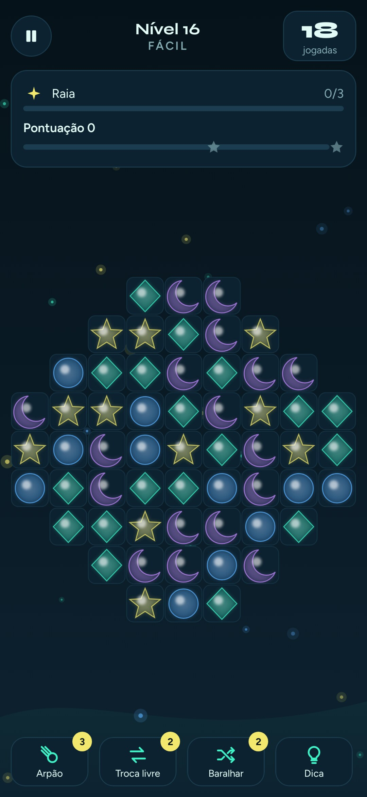
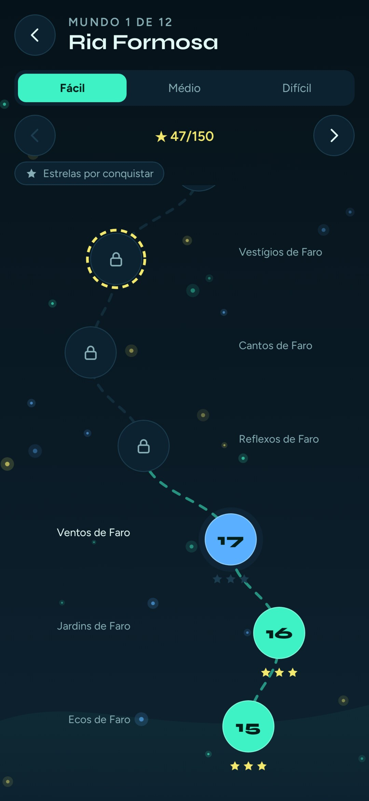
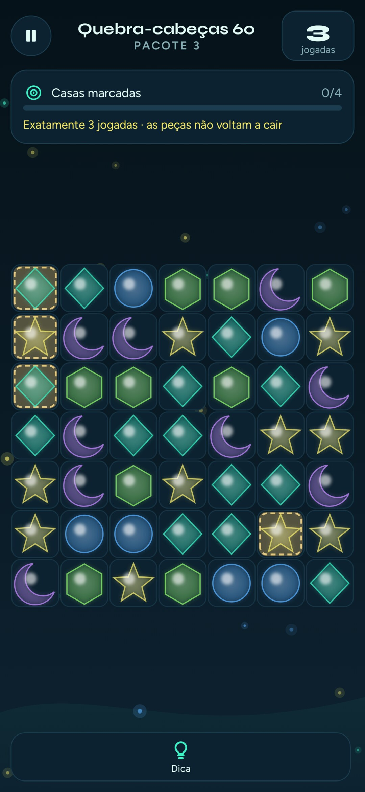

[English](README.md) · **Português (Portugal)**

<h1 align="center">
  
</h1>

<p align="center">
  Um jogo de combinar três para Android, passado na costa portuguesa à noite.<br>
  600 níveis, 12 mundos e 100 quebra-cabeças. Sem anúncios, sem rastreio e sem internet.
</p>

<p align="center">
  <a href="https://github.com/SyscallBrain/night-crush/releases/latest"></a>
  <a href="https://github.com/SyscallBrain/night-crush/actions/workflows/ci.yml"></a>
  <a href="LICENSE"></a>
  
  
  
</p>

<p align="center">
  <a href="https://github.com/SyscallBrain/night-crush/releases/latest"><b>Descarregar</b></a> ·
  <a href="#funcionalidades">Funcionalidades</a> ·
  <a href="#compilar-a-partir-do-código">Compilar</a> ·
  <a href="#como-funciona">Como funciona</a> ·
  <a href="#contribuir">Contribuir</a>
</p>

## Sobre

O NightCrush é um jogo de combinar três passado na costa portuguesa depois do anoitecer. Trocas plâncton luminoso para criar raias, alforrecas, peixes-lanterna e pérolas abissais, e depois combinas os especiais entre si. Cada nível ganho acende um ponto na costa desse mundo, e assim a costa vai-se enchendo de luz à medida que jogas, da Ria Formosa ao Atlântico profundo.

Todos os níveis são certificados. O solucionador incluído no repositório joga até à vitória cada uma das 1 800 variantes. O build volta a reproduzir essas soluções antes de produzir um APK. Se alguma deixar de reproduzir, não há APK.

O jogo está completo e funciona sempre sem internet. Não tem anúncios, contas, estatísticas de utilização nem compras, e a única permissão que pede é a de vibração.

<p align="center">
  
  
  
  
</p>

## Funcionalidades

### Campanha

- **600 níveis** em 12 mundos de 50, cada um em Fácil, Médio e Difícil, o que dá 1 800 variantes certificadas.
- **Quatro especiais:** a raia limpa uma linha ou coluna, a alforreca rebenta as peças à volta, o peixe-lanterna nada até um alvo e a pérola abissal limpa todas as peças de uma cor.
- **Onze combinações de especiais,** da cruz de luz (raia com raia) à maré viva (duas pérolas abissais).
- **Sete objetivos:** recolher cores, limpar lodo, levar lanternas às saídas, cumprir encomendas, partir bloqueadores, espalhar a luz e libertar cavalos-marinhos. Alguns níveis são contra o relógio.
- **Um obstáculo novo em cada mundo:** cracas, lodo, coral, redes, maré negra, remoinhos, correntes marítimas, baiacus, ostras gigantes, sorvedouros e um polvo que lança tinta.
- **Níveis Lua Cheia** com anel dourado no mapa e um baú de mundo no topo de cada caminho.

<details>
<summary><b>Os doze mundos</b></summary>
<br>

| # | Mundo | Níveis | Novidade |
|---:|---|---|---|
| 1 | Ria Formosa | 1–50 | os quatro especiais, combinações de especiais, cracas |
| 2 | Sagres | 51–100 | lodo com uma e duas camadas |
| 3 | Arrábida | 101–150 | lanternas e saídas, deslizamento diagonal |
| 4 | Berlengas | 151–200 | coral e encomendas |
| 5 | Nazaré | 201–250 | redes e os primeiros níveis com tempo |
| 6 | Costa Vicentina | 251–300 | maré negra que se espalha |
| 7 | Fajãs dos Açores | 301–350 | remoinhos e cavalos-marinhos |
| 8 | Porto Moniz | 351–400 | correntes marítimas |
| 9 | Gruta de Benagil | 401–450 | baiacus e luz que se espalha |
| 10 | Ilhas Selvagens | 451–500 | ostras gigantes |
| 11 | Fossa Abissal | 501–550 | sorvedouros |
| 12 | Atlântico Profundo | 551–600 | o polvo e tudo junto |

</details>

### Modos de jogo

- **Desafio diário:** um nível por dia e por dificuldade, que nunca gasta vidas, com o histórico dos teus resultados.
- **Infinito:** níveis certificados em sequência, cada vez mais difíceis, e as jogadas que sobram passam para o seguinte.
- **Corrida de 90 s:** faz o máximo de pontos que conseguires; as cascatas dão mais tempo.
- **Zen:** um tabuleiro aberto, sem objetivos nem pontos e sem pressa.
- **100 quebra-cabeças** em quatro pacotes: tabuleiros fixos e sem reposição, em que as casas marcadas têm de ficar limpas em exatamente N jogadas. O solucionador verifica cada um, por isso N jogadas chegam sempre e N−1 nunca chegam.

### Progressão

- Vidas, Pérolas, boosters e uma série de vitórias que começa o nível seguinte com uma raia, uma alforreca ou um peixe-lanterna.
- Baús de estrelas e de mundo com animação de abertura, recompensa diária, três missões por dia e um evento semanal com cinco patamares.
- **A costa que se ilumina:** um panorama desenhado para cada mundo, com 50 luzes, uma por nível.
- **Uma coleção de 108 cromos,** com nove criaturas do mar em cada mundo.
- **48 conquistas** e um perfil com a taxa de vitória por dificuldade, os especiais criados, a maior cascata e os recordes do jogo livre.

## Acessibilidade

- Paletas para daltonismo (deuteranopia, protanopia e tritanopia) e símbolos de alto contraste desenhados em cada peça.
- **TalkBack no tabuleiro:** cada casa diz a peça, o especial, o bloqueador e as camadas que tem. Há ações para a trocar com uma vizinha, e cada jogada é anunciada.
- Movimento reduzido, que segue o telemóvel até o mudares, e velocidade das animações a 1×, 1,5× ou 2×.
- Texto maior, modo canhoto, volumes separados para efeitos e música, e confirmação antes de baralhar.

## Privacidade

O NightCrush não recolhe nada, e foi feito de forma a não o poder fazer.

- **Sem permissão de internet:** a app não tem como enviar dados para lado nenhum.
- **Uma só permissão:** `VIBRATE`, para a vibração.
- Sem anúncios, contas, estatísticas de utilização, SDKs de terceiros, Google Play Services nem compras na app.
- O teu progresso fica no telemóvel. Podes exportá-lo para um ficheiro e voltar a importá-lo tu mesmo.

## Instalação

1. Descarrega o `NightCrush-v1.0.0.apk` da [última versão](https://github.com/SyscallBrain/night-crush/releases/latest).
2. Abre-o no telemóvel. O Android pede uma vez para permitir instalações a partir do browser ou do gestor de ficheiros.

O NightCrush precisa do Android 8.0 (API 26) ou mais recente. Fala inglês e português europeu e segue o idioma do telemóvel.

## Compilar a partir do código

| Ferramenta | Versão |
|---|---|
| JDK | 17 ou mais recente (compilado com o 21) |
| Android SDK | plataforma `android-37.1` e build tools 37 |
| Gradle | wrapper incluído (9.8.0) |

```bash
git clone https://github.com/SyscallBrain/night-crush.git
cd night-crush
export JAVA_HOME=/caminho/para/jdk ANDROID_HOME=/caminho/para/android-sdk

./gradlew :app:assembleDebug        # app/build/outputs/apk/debug/app-debug.apk
bash tools/verify.sh                # tudo o que a CI corre: testes, validação estrita, certificados, lint, APK
```

Não é preciso emulador. Os ecrãs podem ser gerados na JVM com o Robolectric:

```bash
./gradlew :app:testDebugUnitTest -PncShots --tests '*ScreenshotTest*'   # PNG em app/build/screenshots (PT) e /en
```

O build de release só é assinado quando as propriedades `nightCrush.release.*` estão definidas em `~/.gradle/gradle.properties`. Sem elas, o APK sai sem assinatura.

## Como funciona

O projeto tem três módulos Gradle que partilham um único motor de regras:

| Módulo | O que contém |
|---|---|
| `:core` | O motor em Kotlin/JVM puro: combinações, especiais, gravidade com deslizamento diagonal, bloqueadores, objetivos, pontuação, baralhar determinístico e um hash canónico SHA-256 do estado. Não usa Android, nem relógio, nem o `Random` da plataforma, só um SplitMix64 com versão. |
| `:leveltool` | CLI de conteúdo: gera níveis a partir de famílias estruturais, calibra a dificuldade com um jogador simulado, resolve cada variante e escreve certificados reproduzíveis. Também gera e certifica os quebra-cabeças. |
| `:app` | Interface em Jetpack Compose. O tabuleiro é desenhado num único `Canvas` com sprites pré-renderizados, e as animações são construídas a partir dos eventos do motor. |

```
content/
├── catalog.json            12 mundos e uma entrada por nível (revisão, sha256)
├── levels/world-NN/        os 600 ficheiros de nível
├── certificates/level-N/   soluções em fácil, médio e difícil, com hashes do estado
└── puzzles/puzzles.json    100 quebra-cabeças com as soluções
```

O jogo, o solucionador e o verificador de certificados chamam todos o mesmo `GameEngine.applyMove`. Por isso, um certificado prova que uma pessoa pode ganhar exatamente aquele nível. Qualquer mudança no motor que um jogador possa notar sobe o `ENGINE_VERSION` e obriga a gerar de novo todos os certificados. Em cada build, o `validateGameContent` confirma os hashes do catálogo e reproduz os certificados e os quebra-cabeças. Depois, o `exportGameAssets` põe o conteúdo no APK com um manifesto SHA-256.

## Contribuir

Relatórios de erros, traduções, comentários sobre acessibilidade e pull requests são bem-vindos. Lê primeiro o [CONTRIBUTING.md](CONTRIBUTING.md). Em resumo: as regras ficam no `:core` com testes, o texto visível vai para o `strings.xml` nas duas línguas, e o conteúdo novo tem de passar no `validate --strict` com certificados que reproduzam.

## Créditos

Feito por **Tiago Correia** ([tiagorcorreia87@gmail.com](mailto:tiagorcorreia87@gmail.com)).

Fontes: [Syne](https://fonts.google.com/specimen/Syne) e [Figtree](https://fonts.google.com/specimen/Figtree), ambas sob a SIL Open Font License. Os efeitos sonoros e a música são sintetizados sem internet por [`tools/generate_sounds.py`](tools/generate_sounds.py).

## Licença

O NightCrush é distribuído sob a [licença MIT](LICENSE).
